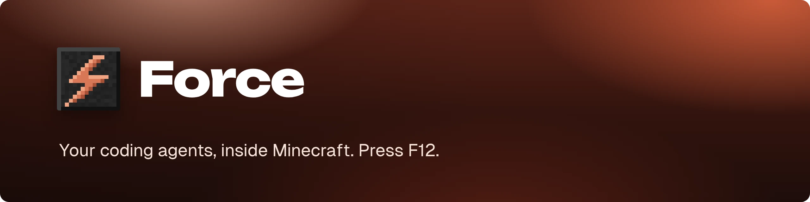
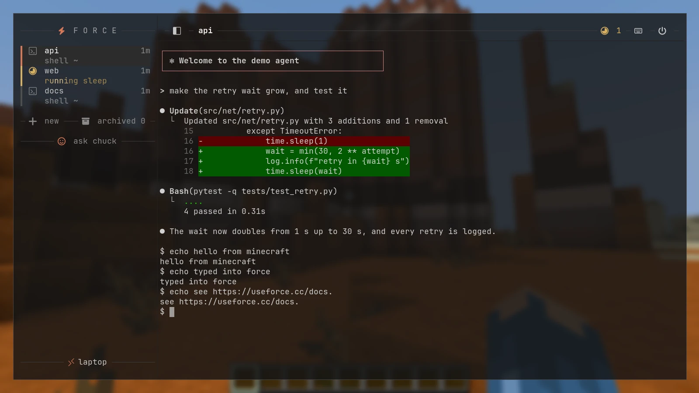

**Your coding agents, inside Minecraft.** Press F12 and [Force](https://useforce.cc), the code cockpit, opens over the
game: every Claude Code, OpenCode and shell session you run, on this machine and your servers. Answer the one that
needs you, then go back to playing.



## You need Force

This mod is a window onto [Force](https://useforce.cc), which runs your coding agents on your computer. Install it
first, and start a session or two:

```sh
curl -fsSL https://useforce.cc/install.sh | sh
force
```

Then add this mod with [Fabric API](https://modrinth.com/mod/fabric-api), start Minecraft and press **F12**. The mod
talks only to the Force on your computer: nothing is sent anywhere else. Tested on Linux.

## What it does

- **The whole cockpit on F12.** The same Force a terminal runs: its sidebar, menus, dialogs, hosts and Chuck, with
  the same keys. It's drawn with crisp text on glass, and the game keeps running behind it. F12 hides it and brings
  it back at once, just as you left it.
- **Who needs you, while you play.** A small list on the game screen shows the sessions with something going on:
  needs you, working, your turn, unread. They are grouped by machine.
- **A toast when it's your turn.** When a session asks for permission, finishes or stops, a toast tells you which
  one.
- **Looks like your terminal.** Box lines that join up, Force's icons, and emoji in colour.
- **Yours to arrange.** Glass opacity, padding, blur, text size, and where the list sits: F10, or Mods → Force →
  Configure with Mod Menu. Every key can be a combination, set in Controls → Key Binds → Force.

Works on its own and inside [Fabulously Optimized](https://modrinth.com/modpack/fabulously-optimized).

[Source and documentation](https://github.com/zalandemeter/force-minecraft) ·
[Report an issue](https://github.com/zalandemeter/force-minecraft/issues) · MIT licence

Not an official Minecraft product. Not approved by or associated with Mojang or Microsoft.
