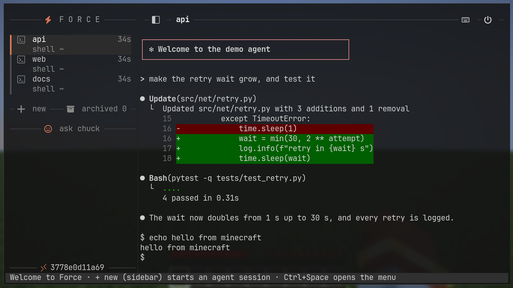
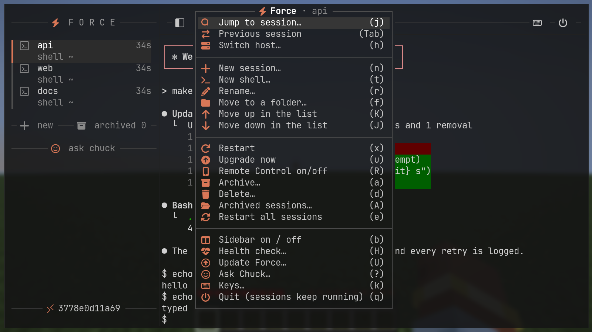
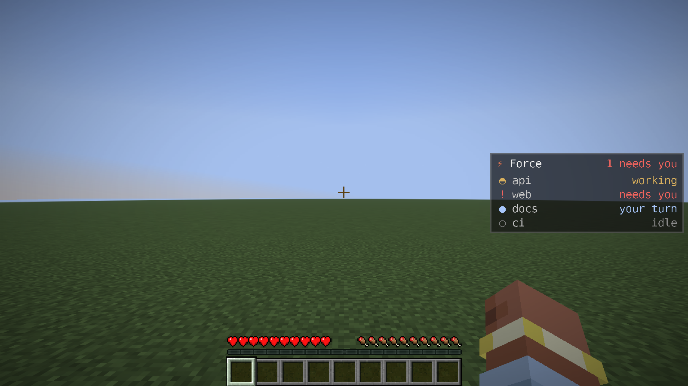

# Force for Minecraft

Your [Force](https://useforce.cc) sessions (Claude Code, OpenCode, shells) inside Minecraft: who needs you on the
game screen, a toast when a session needs you or finishes, and a console to answer it without leaving the game.

A client-side Fabric mod. It is a frontend of Force, not a copy: it talks to your installed Force through
`force api` (Force SPEC §54). F12 opens **the whole Force app** over the running game: the same program a terminal
runs (its sidebar, header, Ctrl+Space menu, dialogs, Alt+N, hosts, Chuck), drawn by the mod with crisp text on
blurred glass instead of terminal blocks. The session list on the game screen and the toasts come from the same
Force: the hosts you added with `force host add`, the states, the order and the unread marks are Force's own.





(Screenshots from the client game tests, against a demo Force.)

## Requirements

- Force with `force api` (Linux), installed as usual: `curl -fsSL https://useforce.cc/install.sh | sh`
- Minecraft 26.2, Fabric Loader 0.20.1+, Fabric API. Works on its own and inside
  [Fabulously Optimized](https://modrinth.com/modpack/fabulously-optimized) 14.1.2, whose versions it follows.
- Java 25 (Minecraft 26.2's).

## Use

| Key | |
|---|---|
| `F12` | show / hide Force: the whole app, full screen. Every other key goes to Force, Esc and Ctrl+Space included; Ctrl+Shift+V pastes |
| `F10` | the settings |
| (unbound) | show / hide the session list on the game screen (it shows from the start; only the sessions with something going on: needs you, working, your turn, unread, host by host) |
| (unbound) | jump to the next session that needs you, in the session view |
| (unbound) | the session view: the native list and one session's terminal (Ctrl+Shift+↑/↓ switch) |

Keys are set in Options → Controls → Key Binds → Force, and each can be a combination: hold Ctrl, Alt or Shift while
pressing the key (Ctrl + F12). A combination fires only with exactly its modifiers, so F12 and Ctrl + F12 can do two
things. If the show / hide key is unbound, Esc hides Force's view, so it can always be left.

The mouse works where Force asks for it: its sidebar cards, header and menus are clickable, the wheel scrolls. The
game keeps running. The app starts hidden as soon as Force is connected and stays running: showing it is instant, and
it is as you left it (its host, its session). Hidden, Force does not count the session it shows as viewed, so you
still get its toasts while you play.

Emoji are drawn in colour, as a terminal draws them: from the system's emoji font (so they look as in your
terminal), else from the Noto Color Emoji the mod brings.

### Settings

Mods → Force → Configure (with [Mod Menu](https://modrinth.com/mod/modmenu), which Fabulously Optimized ships), or
`F10`. Changes show at once:

| Setting | Default | |
|---|---|---|
| Force's view: background | 100% | how solid the glass behind Force is (0% shows the game) |
| Force's view: padding | 0 px | space around it, in GUI pixels (0: edge to edge) |
| Force's view: blur the game | on | |
| Force's view: text size | 100% | on top of Minecraft's GUI scale |
| Session list: background | 75% | |
| Session list: position | right | right, left, or a corner |
| Session list: most sessions | 8 | |
| Session list: show at start | on | |
| Toasts | on | when a session needs you, finishes or stops |
| Key binds… | | opens Controls → Key Binds |

They are kept in `config/force_mc.json`, with a few more for development:

| Key | Default | |
|---|---|---|
| `command` | `["~/.local/bin/force", "api"]` | how to start Force's frontend API |
| `terminalFontPx`, `uiFontPx`, `hudFontPx` | `0` | text sizes in screen pixels (12–48) for the console's terminal, its list, the game-screen list; `0` follows Minecraft's GUI scale (so a high-DPI display gets larger text) |
| `keyModifiers` | `{}` | the modifiers of each key combination (the key itself is in `options.txt`) |

## Versions

The mod follows the newest release (not beta) of Fabulously Optimized:

| | |
|---|---|
| Fabulously Optimized | 14.1.2 |
| Minecraft | 26.2 |
| Fabric Loader | 0.20.1 |
| Fabric API | 0.161.0+26.2 |
| Java | 25 |

It also builds for Minecraft 26.3 (Fabulously Optimized 15 beta) from the same code:
`./gradlew build -Pminecraft_version=26.3 -Pfabric_api_version=0.166.2+26.3 -Pversion=0.1.0+26.3`. Minecraft 26.3
moved its input from GLFW to SDL (other key codes and modifier bits), so the keys go through `KeyTable`, built from
Minecraft's own `InputConstants`.

## Architecture

Built so the UI, the gestures and the terminal technology can change one at a time.

```
src/main/java/cc/useforce/mc/core/      plain Java, no Minecraft (unit-tested)
  ApiConnection, Supervisor             `force api` over stdio: requests, events, restart with backoff
  ForceModel                            what Force said: hosts, sessions, attention, notices (Force decides)
  Selection                             which session is picked: the UI's state, never Force's
  AppTerminal, Vt, VtInput              the whole app (SPEC §54 vt mode): Force runs its ui in a pty, Vt emulates
                                        the terminal (what tmux sends), VtInput encodes keys, pastes and the mouse
  TerminalBackend, CellsBackend         one session's view (cells mode): the native session view
  TerminalBuffer                        the screen both fill: the only thing the view draws
  Intent, Controller                    what the player wants, from any gesture; carried out in one place
  Keys                                  GLFW keys to tmux key names
src/client/java/cc/useforce/mc/         Minecraft
  ui/Theme, Panel                       Force's colours and the glass panels
  ui/SessionList, ui/TerminalView       widgets: draw a model / a buffer, answer "what is here"
  ui/GlyphAtlas, ui/BoxDraw             the text renderer: FreeType glyphs at exact pixel size (colour emoji from
                                        the system's emoji font), box lines
  Hud, AppScreen, ConsoleScreen         layouts: the game screen; the whole app; the session view
  Config, SettingsScreen, ModMenuEntry  the settings: the file, the screen (Minecraft's option widgets), Mod Menu
  ComboKey, mixin/KeyBindsScreenMixin   key bindings that can be combinations, set in Controls → Key Binds
  ForceClient                           wiring: key bindings, toasts, the layouts, the controller
src/gametest/                           the real client, headless: a world, the console, typing, switching, emoji,
                                        the settings, a key combination
```

- A new gesture (a click, a key, the wheel) maps to an existing `Intent`; a new behaviour is a new `Intent`.
- Moving the list (into the HUD, the console, or a side panel) is a layout change; the widgets do not care.
- The app view and the session view fill the same `TerminalBuffer`, so the renderer is shared.
- Next: native panels (sidebar, menus, dialogs) on top of the app, with Force publishing its UI logic for frontends.

## Develop

```sh
./gradlew build                 # the mod and the unit tests (Java 25)
scripts/gametest.sh             # the client game tests in Docker, against a demo Force from ../force
./gradlew runClient             # a dev client; FORCE_MC_COMMAND="/path/to/force api" points it at another Force
```

`scripts/gametest.sh` needs Docker and a Force checkout (`FORCE_REPO`, default `../force`): it builds a Force release
from it, installs that in the container with three shell sessions and its daemon, and runs the client against it.
Screenshots of each step are in `build/run/clientGameTest/screenshots/`.

## Text

The console draws its own text (`ui/GlyphAtlas`): FreeType rasterises each glyph at exactly the pixel size it is
drawn, into texture pages, and everything is drawn in screen pixels rather than Minecraft's scaled GUI units, so text
is crisp at any GUI scale and sizes follow the GUI scale. It does not go through Minecraft's font system, which loads
TTF fonts on several threads at once (FreeType's TrueType hinting interpreter crashes under that with many sizes); one
FreeType library of the mod's own is used by the render thread only, with light auto-hinting. JetBrains Mono (with
its real bold) first, DejaVu Sans Mono and DejaVu Sans for what it lacks; box-drawing and block characters are drawn
as lines and blocks that meet across cells, as terminals do.

## Licence

MIT. Fonts in `assets/force_mc/fonts/`: JetBrains Mono (SIL Open Font License), DejaVu Sans Mono and DejaVu Sans
(Bitstream Vera licence), a subset of Nerd Fonts Symbols (MIT) with Force's icons, and Noto Color Emoji (SIL Open
Font License; googlefonts/noto-emoji v2026-09-24-unicode18_0).
