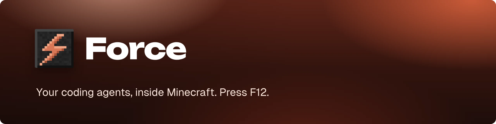
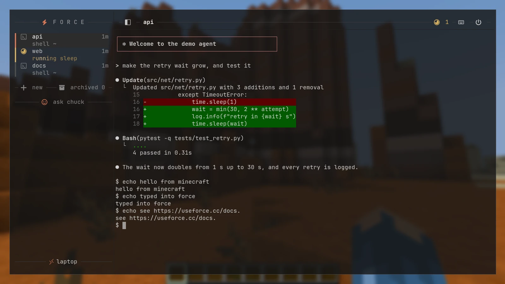
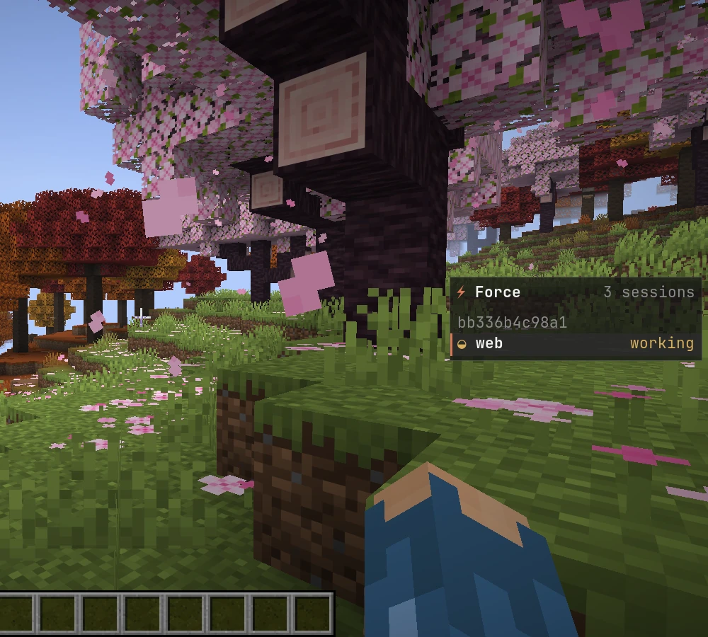
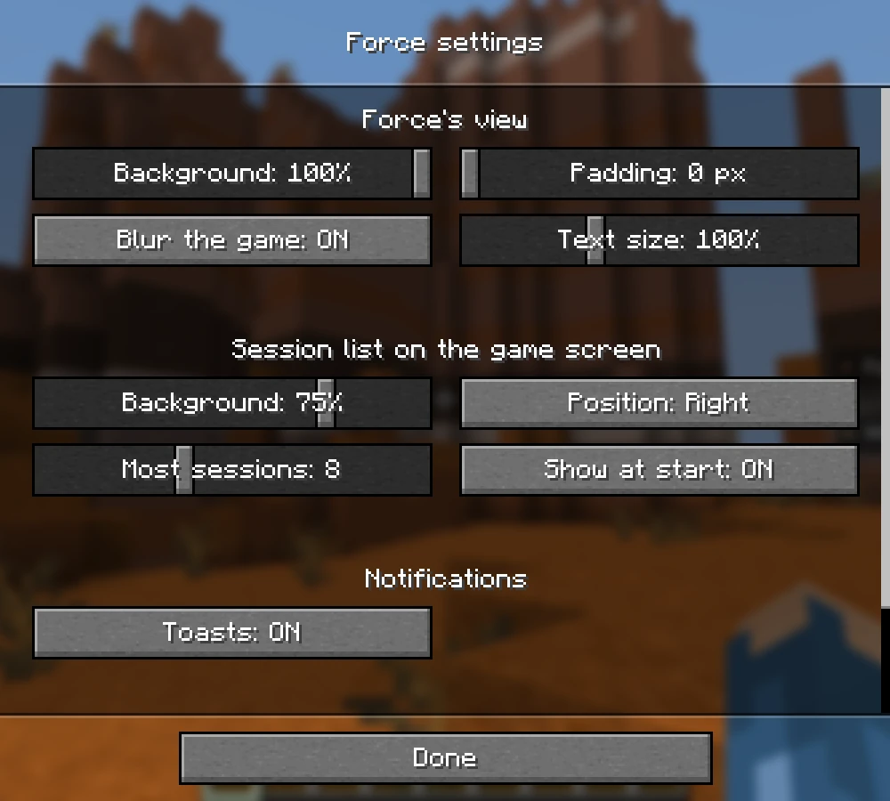

<p align="center">
  <a href="https://useforce.cc"></a>
</p>

<p align="center">
  <a href="https://github.com/zalandemeter/force-minecraft/actions/workflows/build.yml"></a>
  <a href="https://github.com/zalandemeter/force-minecraft/releases/latest"></a>
  
  
  <a href="LICENSE"></a>
  <a href="https://useforce.cc"></a>
</p>

<p align="center">
  <b>Your coding agents, inside Minecraft.</b><br>
  Press F12 and <a href="https://useforce.cc">Force</a>, the code cockpit, opens over the game: every Claude Code,
  OpenCode and shell session you run, on this machine and your servers. Answer the one that needs you, then go back
  to playing.
</p>

<p align="center">
  <a href="https://useforce.cc">Force</a> ·
  <a href="https://github.com/zalandemeter/force-minecraft/releases/latest">Download</a> ·
  <a href="https://github.com/zalandemeter/force-minecraft/issues/new">Report&nbsp;an&nbsp;issue</a>
</p>

<p align="center">
  
</p>

## Install

1. Install Force, if you don't have it yet, and start a session or two:

   ```sh
   curl -fsSL https://useforce.cc/install.sh | sh
   force
   ```

2. Put the mod's jar for your Minecraft version (`force-minecraft-X.Y.Z+26.2.jar` or `…+26.3.jar`, from the
   [latest release](https://github.com/zalandemeter/force-minecraft/releases/latest)) into your `mods` folder,
   with [Fabric API](https://modrinth.com/mod/fabric-api). It works on its own and inside
   [Fabulously Optimized](https://modrinth.com/modpack/fabulously-optimized).

3. Start Minecraft and press <kbd>F12</kbd>.

It is a client-side Fabric mod for Minecraft 26.2 and 26.3 (Java 25), tested on Linux. The mod talks to the Force
you installed: nothing is sent anywhere else.

## What it does

- **The whole cockpit on F12.** The same Force a terminal runs: its sidebar, menus, dialogs, hosts and Chuck, with
  the same keys. It is drawn by the mod with crisp text on glass instead of terminal blocks, and the game keeps
  running behind it. F12 hides it and brings it back at once, just as you left it.
- **Who needs you, while you play.** A small list on the game screen shows the sessions with something going on:
  needs you, working, your turn, unread. They are grouped by machine, in Force's colours.
- **A toast when it's your turn.** When a session asks for permission, finishes or stops, a toast tells you which
  one. A session you are not looking at stays unread, even if it's the one selected in the hidden cockpit.
- **Looks like your terminal.** Box lines that join up, Force's icons, and emoji in colour, from your system's emoji
  font or the Noto Color Emoji the mod brings.
- **Yours to arrange.** How solid the glass is, the padding, the blur, the text size, and where the list sits. Every
  key can be a combination, set in Minecraft's own Controls.

<p align="center">
  
  
</p>

## Keys

| Key | |
|---|---|
| <kbd>F12</kbd> | Show or hide Force. While it shows, every other key goes to Force, <kbd>Esc</kbd> and <kbd>Ctrl</kbd>+<kbd>Space</kbd> included; <kbd>Ctrl</kbd>+<kbd>Shift</kbd>+<kbd>V</kbd> pastes |
| <kbd>F10</kbd> | The settings |
| (not bound) | Show or hide the session list on the game screen (it shows from the start) |
| (not bound) | Jump to the next session that needs you |
| (not bound) | The session view: a native list and one session's terminal |

Change them in Options → Controls → Key Binds → Force. A key can be a combination: hold <kbd>Ctrl</kbd>,
<kbd>Alt</kbd> or <kbd>Shift</kbd> while you press it. A combination works only with exactly those keys held, so
<kbd>F12</kbd> and <kbd>Ctrl</kbd>+<kbd>F12</kbd> can do different things. If you unbind the show / hide key,
<kbd>Esc</kbd> hides Force instead, so you can always get out.

The mouse works where Force asks for it: click its session cards, header and menus, and scroll with the wheel.
Links open in your browser with <kbd>Ctrl</kbd>+click, as in a terminal, also when they wrap onto the next line.

## Settings

Open them with <kbd>F10</kbd>, or in Mods → Force → Configure (with [Mod Menu](https://modrinth.com/mod/modmenu),
which Fabulously Optimized ships). Changes show at once.

| Setting | Default | |
|---|---|---|
| Force's view: background | 80% | how solid the glass behind Force is; at 0% the game shows through |
| Force's view: padding | 10 px | space around it, in GUI pixels; at 0 it runs edge to edge |
| Force's view: blur the game | on | |
| Force's view: text size | 75% | on top of Minecraft's GUI scale |
| Session list: background | 75% | |
| Session list: position | right | right, left, or a corner |
| Session list: most sessions | 8 | |
| Session list: show at start | on | |
| Toasts | on | when a session needs you, finishes or stops |

They are kept in `config/force_mc.json`, with a few more: `command` (how to start Force's frontend API, default
`["~/.local/bin/force", "api"]`), and fixed text sizes in screen pixels (`terminalFontPx`, `uiFontPx`, `hudFontPx`;
`0` follows the GUI scale).

## Contributing

Bug reports and ideas are welcome as [issues](https://github.com/zalandemeter/force-minecraft/issues). How the mod
is built, tested and released, and how its code is laid out: [CONTRIBUTING.md](CONTRIBUTING.md).

## Licence

[MIT](LICENSE). The fonts it brings keep their own licences (in `src/client/resources/assets/force_mc/fonts/`):
JetBrains Mono and Noto Color Emoji (SIL Open Font License), DejaVu Sans Mono and DejaVu Sans (Bitstream Vera
licence), and a subset of Nerd Fonts Symbols (MIT) with Force's icons.

Not an official Minecraft product. Not approved by or associated with Mojang or Microsoft.
