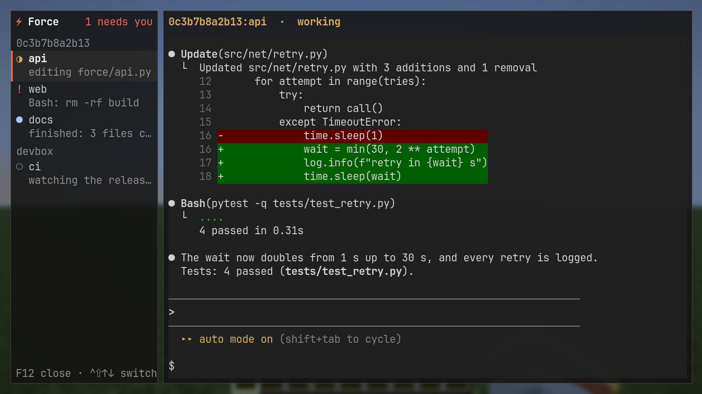

# Force for Minecraft

Your [Force](https://useforce.cc) sessions (Claude Code, OpenCode, shells) inside Minecraft: who needs you on the
game screen, a toast when a session needs you or finishes, and a console to answer it without leaving the game.

A client-side Fabric mod. It is a frontend of Force, not a copy: it talks to your installed Force through
`force api` (Force SPEC §54), so the hosts you added with `force host add`, the states, the order and the unread
marks are Force's own.




(Screenshots from the client game tests, against a demo Force.)

## Requirements

- Force with `force api` (Linux), installed as usual: `curl -fsSL https://useforce.cc/install.sh | sh`
- Minecraft 26.2, Fabric Loader 0.20.1+, Fabric API. Works on its own and inside
  [Fabulously Optimized](https://modrinth.com/modpack/fabulously-optimized) 14.1.2, whose versions it follows.
- Java 25 (Minecraft 26.2's).

## Use

| Key | |
|---|---|
| `F12` | open / close the console: the session list and the selected session's terminal. Every other key goes to the session, Esc included |
| `F10` | show / hide the session list on the game screen |
| (unbound) | jump to the next session that needs you, and open the console |
| Ctrl+Shift+↑/↓ | in the console: the previous / next session |

In the console a click on the list picks a session, the wheel over the terminal scrolls its history (typing
returns to the live screen). The game keeps running; a session shown in the console counts as viewed in Force, so it
is not marked unread meanwhile. All keys can be changed in Options → Controls → Force.

Settings: `config/force_mc.json` (written on the first start):

| Key | Default | |
|---|---|---|
| `command` | `["~/.local/bin/force", "api"]` | how to start Force's frontend API |
| `hud` | `true` | the session list on the game screen |
| `toasts`, `sound` | `true` | a toast when a session needs you, finishes or stops |
| `hudRows` | `8` | the most sessions the game-screen list shows |
| `terminalFontPx`, `uiFontPx`, `hudFontPx` | `0` | text sizes in screen pixels (12–48) for the console's terminal, its list, the game-screen list; `0` follows Minecraft's GUI scale (so a high-DPI display gets larger text) |
| `textScale` | `1.0` | multiplies the sizes that follow the GUI scale |

## Versions

The mod follows the newest release (not beta) of Fabulously Optimized:

| | |
|---|---|
| Fabulously Optimized | 14.1.2 |
| Minecraft | 26.2 |
| Fabric Loader | 0.20.1 |
| Fabric API | 0.161.0+26.2 |
| Java | 25 |

It also builds for Minecraft 26.3 (Fabulously Optimized 15 beta) from the same code:
`./gradlew build -Pminecraft_version=26.3 -Pfabric_api_version=0.166.2+26.3 -Pversion=0.1.0+26.3`. Minecraft 26.3
moved its input from GLFW to SDL (other key codes and modifier bits), so the keys go through `KeyTable`, built from
Minecraft's own `InputConstants`.

## Architecture

Built so the UI, the gestures and the terminal technology can change one at a time.

```
src/main/java/cc/useforce/mc/core/      plain Java, no Minecraft (unit-tested)
  ApiConnection, Supervisor             `force api` over stdio: requests, events, restart with backoff
  ForceModel                            what Force said: hosts, sessions, attention, notices (Force decides)
  Selection                             which session is picked: the UI's state, never Force's
  TerminalBackend                       one live view of a session; CellsBackend now (Force renders, SPEC §54
    TerminalBuffer                        `cells`), a VT-emulator backend later; both fill a TerminalBuffer
  Intent, Controller                    what the player wants, from any gesture; carried out in one place
  Keys                                  GLFW keys to tmux key names
src/client/java/cc/useforce/mc/         Minecraft
  ui/Theme, Panel                       Force's colours and the glass panels
  ui/SessionList, ui/TerminalView       widgets: draw a model / a buffer, answer "what is here"
  Hud, ConsoleScreen                    layouts: where the widgets go (game screen; console)
  ForceClient                           wiring: key bindings, toasts, the layouts, the controller
src/gametest/                           the real client, headless: a world, the console, typing, switching
```

- A new gesture (a click, a key, the wheel) maps to an existing `Intent`; a new behaviour is a new `Intent`.
- Moving the list (into the HUD, the console, or a side panel) is a layout change; the widgets do not care.
- A full terminal emulator is a new `TerminalBackend` filling the same `TerminalBuffer` (Force's `vt` mode).

## Develop

```sh
./gradlew build                 # the mod and the unit tests (Java 25)
scripts/gametest.sh             # the client game tests in Docker, against a demo Force from ../force
./gradlew runClient             # a dev client; FORCE_MC_COMMAND="/path/to/force api" points it at another Force
```

`scripts/gametest.sh` needs Docker and a Force checkout (`FORCE_REPO`, default `../force`); screenshots of each step
are in `run/clientGameTest/screenshots/`.

## Text

The console draws its own text (`ui/GlyphAtlas`): FreeType rasterises each glyph at exactly the pixel size it is
drawn, into texture pages, and everything is drawn in screen pixels rather than Minecraft's scaled GUI units, so text
is crisp at any GUI scale and sizes follow the GUI scale. It does not go through Minecraft's font system, which loads
TTF fonts on several threads at once (FreeType's TrueType hinting interpreter crashes under that with many sizes); one
FreeType library of the mod's own is used by the render thread only, with light auto-hinting. JetBrains Mono (with
its real bold) first, DejaVu Sans Mono and DejaVu Sans for what it lacks; box-drawing and block characters are drawn
as lines and blocks that meet across cells, as terminals do.

## Licence

MIT. Fonts in `assets/force_mc/fonts/`: JetBrains Mono (SIL Open Font License), DejaVu Sans Mono and DejaVu Sans
(Bitstream Vera licence).
